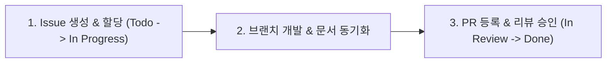

# NURA Avionics 협업 및 기여 가이드 (CONTRIBUTING)

NURA 2027 로켓 동아리 팀원을 위한 **단일 통합 협업 가이드(SSOT)**입니다.  
복잡한 Git CLI 명령어나 개발 환경 설정에 대한 부담 없이, **Antigravity IDE**와 GitHub을 기반으로 빠르고 안전하게 협업합니다.

---

## ⚡ 1. Antigravity 3분 퀵스타트 (자연어 협업 레시피)

터미널 명령어를 일일이 기억할 필요가 없습니다. Antigravity 채팅창에 아래와 같이 **자연어**로 요청하면 에이전트가 브랜치 생성, 코드 작성, 로컬 빌드 검증, 문서 갱신, PR 등록까지 자동으로 처리합니다.

| 상황 | Antigravity에 보낼 자연어 프롬프트 예시 |
|---|---|
| **작업 시작** | `"GitHub 이슈 #10 작업할 브랜치 만들고 시작해줘"` |
| **기능 개발 + 문서 동시 반영** | `"BMP388 센서 SPI 읽기 함수 구현하고, docs/wiki/interfaces/pinout-matrix.md와 관련 위키도 함께 갱신해줘"` |
| **회의록/자료 위키 반영** | `"docs/raw/meetings/에 메모 적어둔 오늘 회의록을 위키 규약(WIKI_PROTOCOL)에 맞춰 Living Wiki에 반영하고 PR 올려줘"` |
| **펌웨어 빌드/검증** | `"firmware 디렉터리에서 pio 빌드 돌려보고 에러 나는 부분 고쳐줘"` |
| **PR 등록** | `"지금까지 작업한 내용 요약해서 PR 템플릿 양식에 맞춰 PR 올려줘"` |
| **동료 코드 리뷰** | `"PR #12 변경점 분석해서 규정 위반이나 핀맵 충돌 없는지 리뷰 코멘트 작성해줘"` |

---

## 🔄 2. 기본 협업 사이클 (3단계)

### 1단계: Issue 생성 및 카드 이동
* 작업할 내용이 생기면 [GitHub Issues](../../issues)에서 새 이슈를 만듭니다.
* 템플릿(`Task` 또는 `Bug`)을 선택하고 **담당자(Assignee)**를 본인으로 지정합니다.
* GitHub Projects(칸반 보드)에서 해당 이슈 카드를 `Todo` -> `In Progress`로 이동합니다.

### 2단계: 브랜치 생성 및 작업 (코드-문서 원자적 반영)
* `main` 브랜치에서 작업용 새 브랜치를 생성합니다.
  * 기능 개발: `feat/<이슈번호>-<간단한설명>` (예: `feat/10-flash-driver`)
  * 버그 수정: `fix/<이슈번호>-<간단한설명>` (예: `fix/15-spi-timeout`)
  * 순수 문서/기타: `docs/<간단한설명>` (예: `docs/system-design-update`, 단순 오탈자 및 독립 기획서)
* **⭐ 기능 단위 PR과 문서 동시 반영 원칙 (Atomic PR)**:
  * 로켓 아비오닉스는 하드웨어 핀맵, 통신 패킷, 상태 머신과 코드의 일치가 생명입니다.
  * 기능 구현/수정 시 수반되는 문서(`docs/wiki/interfaces/` 핀맵·패킷, 서브시스템 위키, ADR 등)는 **별도 PR로 미루지 않고 해당 기능 PR에 반드시 함께 포함**합니다.
* 커밋 메시지는 어떤 작업을 했는지 명확히 한국어 또는 영문으로 작성합니다.
  * 예: `feat: SPI 플래시 메모리 읽기/쓰기 구현 및 핀맵 문서 동기화 (#10)`

### 3단계: Pull Request 등록 및 머지
* 작업이 완료되면 [Pull Requests](../../pulls)를 등록합니다.
* PR 본문에 `Closes #<이슈번호>`를 적어 머지 시 이슈가 자동으로 닫히도록 연동합니다.
* **셀프 체크**: 동작 확인 결과(빌드 로그, 회로 확인 등)와 관련 문서 갱신이 포함되었는지 확인합니다.
* 팀원 최소 1명의 확인/승인을 받은 후 `Squash and merge`로 병합합니다.

---

## 📋 3. 프로젝트 관리 및 라벨 체계

### 3.1 칸반 보드 컬럼 (Status)

| 컬럼 | 설명 | 비고 |
|---|---|---|
| **Todo** | 앞으로 진행할 작업 및 등록된 이슈 | Issue 생성 시 자동/기본 등록 |
| **In Progress** | 현재 팀원이 착수하여 작업 중인 항목 | Assignee 본인 지정 |
| **In Review** | 작업 완료 후 PR이 올라와 검토를 기다리는 항목 | PR 생성 시 자동 이동 |
| **Done** | PR 머지 및 동작 검증이 완료된 항목 | PR 머지 시 자동 Close |

### 3.2 분야 라벨 (Part)
* `HW`: 비행 컴퓨터 회로도, PCB 아트워크, 전원, 부품 선정 ([[docs/wiki/systems/flight-computer|Flight Computer]])
* `FW`: 온보드 펌웨어, 센서 드라이버, 비행 상태 머신 ([[docs/wiki/systems/flight-state-machine|FSM]])
* `GNC`: 자세 추정, 칼만 필터(EKF), 비행 동역학, 제어 알고리즘
* `GS`: 지상국 수신 소프트웨어, 안테나, 모니터링 UI ([[docs/wiki/systems/telemetry-protocol|Telemetry/RF]])
* `DOC`: 시스템 종합 설계서, 인터페이스 명세서, 회의록

### 3.3 우선순위 라벨 (Priority)
* `P0`: **필수 비행 안전 기능** (전원 차단 방지, 사출 감지, 비행 데이터 로깅)
* `P1`: **주요 임무 기능** (지상국 텔레메트리 송수신, 비상 명령)
* `P2`: **고도화 기능** (카나드 제어, 능동 롤 안정화)

---

## 🛡️ 4. 주의사항 (안전 및 데이터 원칙)

* **민감 정보 절대 커밋 금지**: Wi-Fi 비밀번호, API 토큰, 개인 연락처 등은 커밋하지 않습니다.
* **대용량 파일 Git 업로드 금지**:
  * 고속 센서 원본 로그(`csv`), 고해상도 지상 시험 영상(`mp4`), PCB 제조 출력물(`gerber zip`) 등 대용량 바이너리는 저장소에 올리지 않고, **팀 공유 드라이브(Google Drive)**에 업로드한 후 링크로 공유합니다.
* **사전 동작 확인 필수**: 코드를 올리기 전에 로컬 빌드(`pio run`) 또는 회로 확인을 거치고 PR 본문에 결과를 첨부합니다.
* **미확정 사양 임의 단정 금지**: 아직 하드웨어 팀원들과 합의되지 않은 GPIO 핀이나 임계값은 코드에 하드코딩하지 않고 `(미확정 - 팀원 논의 필요)` 상태로 명시하거나 이슈로 발제합니다.

---

## ⚙️ 5. 저장소 및 브랜치 보호 정책 (안전 장치)

* **`main` 브랜치 직접 푸시(Direct Push) 절대 금지**:
  * `main`은 항상 비행 가능한 릴리스 형상을 유지해야 하므로, 관리자를 포함한 모든 팀원은 반드시 PR을 거쳐야만 코드를 반영할 수 있습니다.
* **Squash and merge 필수**:
  * 여러 개의 자잘한 작업 커밋을 단일 기능 단위 커밋으로 깔끔하게 합쳐서 병합합니다.
* **최소 1인 이상 동료 승인 필수**:
  * PR 머지 전 최소 1명 이상의 팀원 확인/승인을 받아야 합니다.
* **헤드 브랜치 자동 삭제**:
  * 머지가 완료된 작업 브랜치(`feat/...`, `fix/...`)는 GitHub이 자동으로 삭제하여 저장소를 청결하게 유지합니다.

