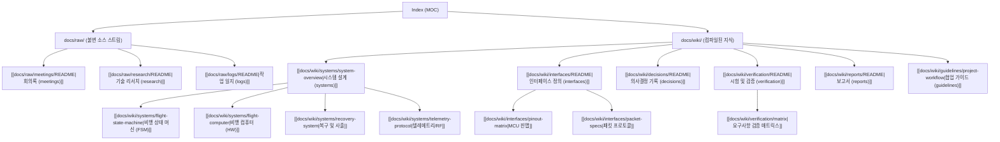

# 🚀 NURA Avionics 지식 베이스 (MOC)

> [!NOTE]
> 본 문서는 NURA 400m 로켓 Avionics 프로젝트의 **Map of Content (MOC)**입니다.
> **Karpathy의 LLM Wiki** 패러다임에 따라, 원시 입력 스트림(`docs/raw/`)과 정제된 영구 지식(`docs/wiki/`)을 연결하는 지식 그래프의 중심 허브 역할을 합니다.
> 운영 원칙과 AI 에이전트 작업 지침은 [[docs/WIKI_PROTOCOL|LLM Wiki 큐레이터 프로토콜]]을 참조하십시오.

---

## 🗺️ 지식 그래프 조망 (Map of Contents)

---

## 🏛️ Living Wiki (영구 지식 레이어)

팀원과 LLM 에이전트가 지속적으로 정리하고 다듬는 살아있는 지식입니다.

### 1. 서브시스템 및 핵심 엔티티 (`docs/wiki/systems/`)
- [[docs/wiki/systems/system-overview|시스템 종합 개요 (System Overview)]]: 400m 미션 목표, 운용 개념(CONOPS), 서브시스템 구조
- [[docs/wiki/systems/flight-state-machine|비행 상태 머신 (Flight State Machine)]]: 6단계 비행 모드 전이 및 결함 격리 로직
- [[docs/wiki/systems/flight-computer|비행 컴퓨터 (Flight Computer)]]: 주 처리 MCU, 전원 PMIC, 워치독, 온보드 로깅
- [[docs/wiki/systems/recovery-system|복구 및 사출 시스템 (Recovery System)]]: 정점 감지, 2중 사출 화약 격발, RBF 안전 핀
- [[docs/wiki/systems/telemetry-protocol|텔레메트리 및 통신 (Telemetry & RF)]]: LoRa 무선 다운링크 및 지상국 업링크 명령

### 2. 인터페이스 규격 (`docs/wiki/interfaces/`)
- [[docs/wiki/interfaces/README|인터페이스 총괄 안내]]
- [[docs/wiki/interfaces/pinout-matrix|하드웨어 핀맵 매트릭스 (Pinout)]]: MCU 핀 할당, 통신 버스(SPI, I2C, UART)
- [[docs/wiki/interfaces/packet-specs|통신 패킷 프로토콜 명세 (Packet Specs)]]: 다운링크/업링크 패킷 구조체 및 데이터 단위

### 3. 기술 의사결정 (`docs/wiki/decisions/`)
- [[docs/wiki/decisions/README|ADR 레지스트리 (Decisions)]]
- [[docs/wiki/decisions/ADR-001-mcu-selection|ADR-001: 주 비행 컴퓨터 MCU 및 펌웨어 플랫폼 선정]]

### 4. 시험 및 검증 (`docs/wiki/verification/`)
- [[docs/wiki/verification/README|검증 체계 안내]]
- [[docs/wiki/verification/matrix|요구사항 추적 매트릭스 (Verification Matrix)]]: REQ-SYS-001 ~ 005 검증 상태

### 5. 공식 보고서 (`docs/wiki/reports/`)
- [[docs/wiki/reports/README|프로젝트 보고서 공간]]

### 6. 협업 및 운영 가이드 (`docs/wiki/guidelines/`)
- [[docs/wiki/guidelines/project-workflow|GitHub Projects 칸반 및 협업 가이드]]: 보드 컬럼, 라벨 체계, PR 라이프사이클
- [[docs/wiki/guidelines/repository-settings|GitHub 저장소 및 브랜치 보호 설정]]: main 브랜치 보호 및 머지 정책

---

## 📥 Raw Stream (원시 기록 레이어)

수정하지 않는 불변의 원시 입력 자료들입니다. LLM 에이전트는 이 자료를 주기적으로 읽고 Living Wiki를 갱신합니다.

- [[docs/raw/meetings/README|회의록 모음 (meetings/)]]
  - [[docs/raw/meetings/2026-10-12-kickoff|2026-10-12 킥오프 회의록]]
- [[docs/raw/research/README|기술 리서치 원본 (research/)]]
- [[docs/raw/logs/README|개발 및 시험 일지 (logs/)]]

---

## 🛠️ 공용 템플릿 (`docs/templates/`)

Obsidian 템플릿(Alt+T 또는 Cmd/Ctrl+P -> Insert Template)을 사용하여 새 노트를 빠르게 생성합니다.

- [[docs/templates/template-system-entity|시스템 엔티티 템플릿]]: 새 서브시스템/개념 문서 작성용
- [[docs/templates/template-raw-meeting|회의록 템플릿]]: 일자별 회의록 작성용
- [[docs/templates/template-raw-research|리서치 템플릿]]: 칩셋/수식 분석용
- [[docs/templates/template-adr|ADR 템플릿]]: 아키텍처 의사결정 기록용
- [[docs/templates/template-verification-test|시험 절차/결과 템플릿]]: 검증 시험 기록용

---

## 🏷️ 태그 분류 (Tag Hierarchy)

- `#domain/avionics`: 에비오닉스 전반
- `#system/fsw`, `#system/hw`, `#system/gnc`, `#system/rf`, `#system/recovery`: 서브시스템별 태그
- `#type/moc`, `#type/system`, `#type/interface`, `#type/adr`, `#type/verification`, `#type/raw`: 문서 성격 태그
- `#status/draft`, `#status/active`, `#status/accepted`, `#status/deprecated`: 진행 상태 태그
