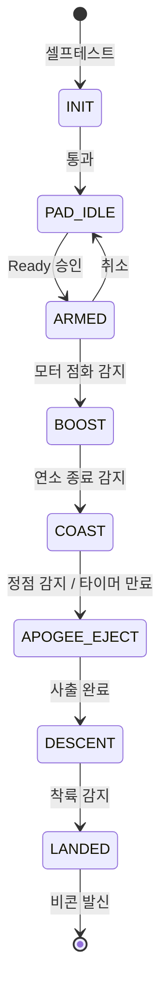

# 🚀 NURA Avionics 시스템 종합 설계서

> [!NOTE]
> 본 문서는 NURA 400m 소형 로켓의 비행 컴퓨터, 펌웨어, 통신 및 복구 시스템의 통합 설계를 기술합니다.
> **Karpathy LLM Wiki** 구조에 따라 각 영역별 원자적(Atomic) 상세 명세는 아래 엔티티 노트를 통해 지속 관리됩니다:
> - 비행 상태 머신 및 CONOPS: [[docs/wiki/systems/flight-state-machine|비행 상태 머신 (FSM)]]
> - 하드웨어 및 MCU 사양: [[docs/wiki/systems/flight-computer|비행 컴퓨터 하드웨어]]
> - 사출 및 안전 복구: [[docs/wiki/systems/recovery-system|복구 및 사출 시스템]]
> - 무선 텔레메트리: [[docs/wiki/systems/telemetry-protocol|텔레메트리 및 통신]]
> - 전기 핀맵 및 패킷: [[docs/wiki/interfaces/pinout-matrix|핀맵 매트릭스]], [[docs/wiki/interfaces/packet-specs|패킷 명세]]
> - 요구사항 검증 상태: [[docs/wiki/verification/matrix|요구사항 검증 매트릭스]]
> - 전체 지식 허브: [[docs/Index|Index (MOC)]]

---

## 1. 개요 및 미션 목표

본 문서는 NURA 400m 소형 로켓의 비행 컴퓨터(Flight Computer), 펌웨어, 통신 및 복구 시스템의 통합 설계를 기술한다.

### 1.1 임무 목표
- **목표 고도**: 지표면 기준 400 m 도달
- **핵심 임무**: 비행 중 센서 데이터의 안정적 로깅, 정점(Apogee) 감지 및 낙하산 자율 사출, 지상국 텔레메트리 송신
- **성공 기준**:
  1. 발사 후 착륙까지 전 과정의 비행 데이터(기압, 가속도, 각속도, GPS 등) 손실 없는 온보드 기록
  2. 정점 도달 시 신뢰성 있는 복구장치 사출 및 기체 감속 회수
  3. 지상국과의 실시간 무선 링크 유지 및 비행 상태 수신

### 1.2 기능 범위 및 우선순위
시스템 기능은 비행 안전성을 최우선으로 하여 3단계로 구분한다.

- **P0 (최우선 필수 안전 기능)**:
  - 안정적 전원 공급 및 감시 ([[docs/wiki/systems/flight-computer|비행 컴퓨터]])
  - 온보드 센서 기반 비행 상태 판정 ([[docs/wiki/systems/flight-state-machine|비행 상태 머신]])
  - 독립적인 고속 온보드 데이터 로깅 (Flash / SD)
  - 외부 통신 실패와 무관한 자율 복구장치 사출 격발 ([[docs/wiki/systems/recovery-system|복구 시스템]])
- **P1 (원격 모니터링 및 보조 기능)**:
  - 실시간 무선 텔레메트리 송신 및 지상국 연동 ([[docs/wiki/systems/telemetry-protocol|텔레메트리/RF]])
- **P2 (고도화 제어 기능)**:
  - Roll 축 안정화 및 Canard 능동 제어

---

## 2. 운용 개념 (CONOPS) 및 비행 단계

비행 국면은 6개 주요 단계로 순차 진행되며, 상세 전이 로직은 [[docs/wiki/systems/flight-state-machine|비행 상태 머신]]에 정의됩니다.

1. **대기 및 점검 (Pad Idle / Pre-flight)**: 지상 점검 및 센서 보정, GPS 락
2. **동력 비행 (Boost)**: 모터 점화 및 가속도 감지, 100 Hz 고속 로깅 시작
3. **무동력 상승 (Coast)**: 모터 연소 종료 후 관성 상승, 수직 속도 감소 추적
4. **정점 및 사출 (Apogee & Ejection)**: 최고 고도 도달 즉시 1.0초 이내 사출 신호 인가
5. **감속 하강 (Descent)**: 낙하산 전개 후 안정적인 종단 속도 유지 및 GPS 5 Hz 브로드캐스팅
6. **착륙 및 회수 (Landed / Recovery)**: 착륙 감지 후 비콘 발신 및 플래시 쓰기 잠금

---

## 3. 비행 모드 (FSM)

상태별 임계값과 결함 격리 대책은 [[docs/wiki/systems/flight-state-machine|비행 상태 머신]]을 참조하십시오.

---

## 4. 서브시스템 및 인터페이스 참조

- 주 처리장치: ESP32-S3-WROOM-1-N16R8 ([[docs/wiki/decisions/ADR-001-mcu-selection|ADR-001]]) (ESP-IDF + FreeRTOS, Single PlatformIO 프로젝트)
- 하드웨어 핀맵: [[docs/wiki/interfaces/pinout-matrix|하드웨어 핀맵 매트릭스]]
- 무선 패킷 명세: [[docs/wiki/interfaces/packet-specs|통신 패킷 프로토콜 명세]]

---

## 5. 핵심 요구사항 및 검증

| ID | 요구사항 내용 | 대상 서브시스템 | 우선순위 | 검증 매트릭스 링크 |
|---|---|---|---|---|
| REQ-SYS-001 | 목표 고도 400 m 비행 환경에서 무결성 유지 | SYS, HW | P0 | [[docs/wiki/verification/matrix\|REQ-SYS-001]] |
| REQ-SYS-002 | 정점 판정 후 1.0초 이내 사출 격발 인가 | FSW, HW | P0 | [[docs/wiki/verification/matrix\|REQ-SYS-002]] |
| REQ-SYS-003 | 비행 중 기압/IMU 데이터 100 Hz 이상 로깅 | FSW | P0 | [[docs/wiki/verification/matrix\|REQ-SYS-003]] |
| REQ-SYS-004 | 통신 두절 시에도 사출 및 로깅 독자 완수 | FSW, SYS | P0 | [[docs/wiki/verification/matrix\|REQ-SYS-004]] |
| REQ-SYS-005 | 비행 중 주요 상태 및 GPS 5 Hz 이상 지상국 전송 | RF, GS | P1 | [[docs/wiki/verification/matrix\|REQ-SYS-005]] |

---

## 6. 위험 분석 및 안전 대책

| 위험 ID | 위험 시나리오 | 영향도 | 안전 대책 (Mitigation) | 관련 위키 |
|---|---|---|---|---|
| HAZ-001 | 지상 대기 중 사출 화약 오발 | 안전 사고 및 기체 파손 | 물리적 RBF 핀 및 Arming 스위치 2중 차단 | [[docs/wiki/systems/recovery-system\|복구 시스템]] |
| HAZ-002 | 정점 미감지로 인한 탄도 비행 | 지상 충돌 위험 | 센서 융합(기압+가속도) 및 백업 타이머 강제 사출 | [[docs/wiki/systems/recovery-system\|복구 시스템]] |
| HAZ-003 | 전원 노이즈로 인한 MCU 재부팅 | 비행 제어 상실 | 전원 분리 설계 및 비휘발성 상태 복구 로직 | [[docs/wiki/systems/flight-computer\|비행 컴퓨터]] |
| HAZ-004 | 진동으로 인한 배터리 이탈 | 시스템 전원 차단 | 잠금형 커넥터(Molex/JST-GH) 및 완충재 고정 | [[docs/wiki/systems/flight-computer\|비행 컴퓨터]] |
