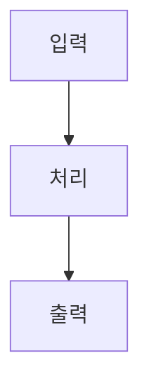

# 🛸 {{title}}

> [!NOTE]
> 본 문서는 [서브시스템/모듈명]의 상세 기능 및 인터페이스를 기술하는 엔티티 위키입니다.
> 상위 개요는 [[docs/wiki/systems/system-overview|시스템 종합 개요]] 및 [[docs/Index|Index (MOC)]]를 참조하십시오.

---

## 1. 개요 및 목적
- 서브시스템의 책임 범위와 핵심 목표를 기술합니다.

## 2. 세부 설계 및 동작 원리
- 하드웨어 회로 구성, 펌웨어 알고리즘, 상태 전이 등을 기술합니다.

## 3. 인터페이스 규격
- 전기적 핀맵: [[docs/wiki/interfaces/pinout-matrix|하드웨어 핀맵]]
- 통신 패킷: [[docs/wiki/interfaces/packet-specs|패킷 명세]]

## 4. 위험 분석 및 안전 대책
- 고장 시 대응 및 안전 격리 방안을 기술합니다.

---

## 5. 연관 문서
- [[docs/wiki/systems/system-overview|시스템 종합 개요]]
- [[docs/wiki/verification/matrix|요구사항 검증 매트릭스]]
