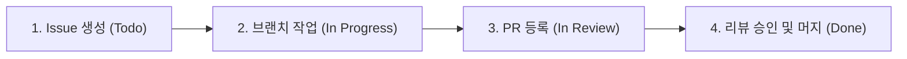

# 📋 GitHub Projects 칸반 및 협업 가이드

> [!NOTE]
> NURA Avionics 팀의 일정 및 작업 진행 상황은 GitHub Projects(칸반 보드)를 통해 직관적으로 관리합니다.
> 전체 지식 맵은 [[docs/Index|Index (MOC)]]를, 기여 기본 규칙은 [[CONTRIBUTING|기여 가이드 (CONTRIBUTING.md)]]를 참조하십시오.

---

## 1. 칸반 보드 컬럼 구성 (Status)

| 컬럼 | 설명 | 비고 |
|---|---|---|
| **Todo** | 앞으로 해야 할 작업 또는 등록된 이슈 | Issue 생성 시 기본 등록 |
| **In Progress** | 현재 팀원이 착수하여 개발/작업 중인 항목 | Assignee 본인 지정 |
| **In Review** | 작업 완료 후 PR이 올라와 팀원의 리뷰를 기다리는 항목 | PR 생성 시 자동 이동 |
| **Done** | PR 머지 및 타깃 보드/시뮬레이션 동작 확인 완료 항목 | PR 머지 시 자동 Close |

---

## 2. 권장 라벨 체계 (Labels)

### 2.1 분야 (Part)
- `HW`: 비행 컴퓨터 회로도, PCB 아트워크, 전원, 부품 선정 ([[docs/wiki/systems/flight-computer|Flight Computer]])
- `FW`: 온보드 펌웨어, 센서 드라이버, 비행 상태 머신 ([[docs/wiki/systems/flight-state-machine|FSM]])
- `GNC`: 자세 추정, 칼만 필터, 비행 동역학, 제어 알고리즘
- `GS`: 지상국 수신 소프트웨어, 안테나, 모니터링 UI ([[docs/wiki/systems/telemetry-protocol|Telemetry/RF]])
- `DOC`: 시스템 설계서, 인터페이스 명세서, 회의록 ([[docs/Index|Index]])

### 2.2 우선순위 (Priority)
- `P0`: **필수 비행 안전 기능** (전원 유지, 자율 사출, 비행 데이터 로깅)
- `P1`: **주요 임무 기능** (지상국 텔레메트리 송수신, 비상 명령)
- `P2`: **고도화 기능** (카나드 제어, 능동 롤 안정화)

---

## 3. 기본 협업 흐름 (Workflow)

1. **작업 시작**:
   - Issue를 생성하고 본인을 `Assignee`로 지정합니다.
   - 보드에서 해당 카드를 `In Progress`로 옮깁니다.
2. **개발 진행**:
   - `feat/<이슈번호>-<설명>` 또는 `fix/<이슈번호>-<설명>` 브랜치를 생성하여 작업합니다.
3. **PR 등록 및 검토**:
   - 작업 완료 후 PR을 생성하면 카드가 `In Review`로 이동합니다.
   - 팀원 1명 이상의 리뷰와 확인을 받습니다.
4. **머지 및 완료**:
   - `main` 브랜치에 `Squash and merge`되면 Issue가 자동으로 닫히고 `Done`으로 이동합니다.

---

## 4. 연관 문서
- [[CONTRIBUTING|기여 가이드 (CONTRIBUTING.md)]]
- [[docs/wiki/guidelines/repository-settings|GitHub 저장소 설정 가이드]]
- [[docs/WIKI_PROTOCOL|LLM Wiki 큐레이터 프로토콜]]
