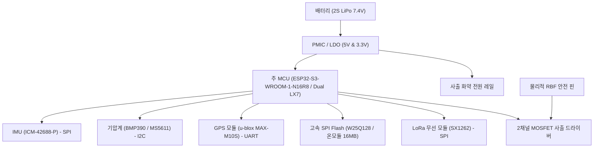

# 💻 비행 컴퓨터 하드웨어 및 MCU (Flight Computer)

> [!NOTE]
> 본 문서는 NURA Avionics의 메인 탑재 컴퓨터 하드웨어 아키텍처, MCU 사양, 전원 공급 및 온보드 로깅 시스템을 다룹니다.
> 전기적 연결 핀맵은 [[docs/wiki/interfaces/pinout-matrix|하드웨어 핀맵 매트릭스]]를 참조하십시오.

---

## 1. 아키텍처 구성

비행 컴퓨터는 진동과 가속도가 극심한 로켓 비행 환경에서 안전하게 동작하도록 설계됩니다.

---

## 2. 주 처리장치 (MCU) 사양

- **선정 모듈**: Espressif ESP32-S3-WROOM-1-N16R8 (관련 결정: [[docs/wiki/decisions/ADR-001-mcu-selection|ADR-001: 주 비행 컴퓨터 MCU 및 펌웨어 플랫폼 선정]])
- **프로세서 코어**: Xtensa® Dual-core 32-bit LX7 @ 최대 240 MHz (벡터 명령어 가속 지원)
- **온보드 메모리**: 16 MB Quad SPI Flash, 8 MB Octal PSRAM, 512 KB 내부 SRAM
- **펌웨어 프레임워크**: ESP-IDF + FreeRTOS (단일 PlatformIO 프로젝트로 일원화 빌드)
- **하드웨어 및 시스템 안전 기능**:
  - 듀얼 코어 태스크 격리: Core 0(센서 수집 & EKF) / Core 1(통신, 로깅, 사출 FSM) 완전 분리
  - 인터럽트 및 태스크 워치독 타이머 (IWDT / TWDT): 태스크 행(Hang) 발생 시 500 ms 이내 자동 안전 조치
  - 갈색 전압 감시 (Brown-out Detector, BOD): 배터리 급격 강하 시 안전 상태 보존 후 리셋
  - 하드웨어 가속기: CRC, AES, SHA 하드웨어 연산 지원

---

## 3. 전원 및 배터리 시스템 (Power Architecture)

> [!WARNING]
> 서보 및 화약 사출 시 대전류가 소모되므로, MCU 로직 전원과 액추에이터 전원은 물리적으로 분리된 LDO/DC-DC를 사용합니다.

1. **배터리**: 2S LiPo (7.4 V 공칭, 450~850 mAh)
2. **레귤레이터 구성**:
   - 로직 레일 (3.3 V): 저잡음 고정밀 LDO (MCU, IMU, 기압계)
   - RF 레일 (3.3 V): 독립 1A LDO (LoRa 송신 시 피크 전류 대응)
   - 액추에이터 레일 (VBAT 직결): 사출 화약 및 서보 구동 전원
3. **전원 차단 안전 장치**:
   - `Remove-Before-Flight (RBF)` 물리적 핀을 장착하여 지상 보관 시 배터리 물리 차단 유지

---

## 4. 온보드 데이터 로깅 (Data Logging)

`REQ-SYS-003` 요구사항에 따라 100 Hz 이상의 고속 비행 데이터를 무손실 저장합니다.

- **저장 매체**: 128 Mbit (16 MB) SPI NOR Flash (W25Q128)
- **로깅 포맷**: 바이너리 패킷 스트림 (타임스탬프, 기압 고도, 9축 가속도/각속도, GPS, 비행 상태)
- **버퍼링 구조**: 링 버퍼(Ring Buffer) 기반 DMA 전송으로 MCU 연산 지연 방지
- **착륙 후 처리**: 지상국 USB 연결 또는 무선 다운로드를 통해 CSV로 변환 추출

---

## 5. 연관 문서
- [[docs/wiki/systems/system-overview|시스템 종합 개요]]
- [[docs/wiki/systems/flight-state-machine|비행 상태 머신]]
- [[docs/wiki/interfaces/pinout-matrix|하드웨어 핀맵 매트릭스]]
- [[docs/wiki/decisions/ADR-001-mcu-selection|ADR-001: 주 비행 컴퓨터 MCU 및 펌웨어 플랫폼 선정]]
- [[docs/wiki/verification/matrix|요구사항 검증 매트릭스 (REQ-SYS-001, 003)]]
