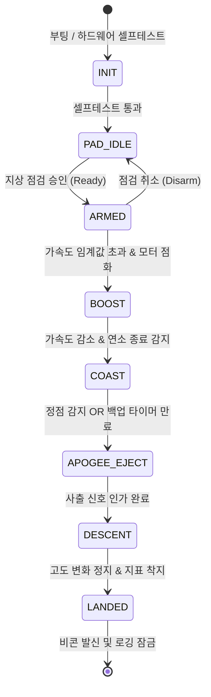

# ⏱️ 비행 모드 및 상태 머신 (Flight State Machine)

> [!NOTE]
> 비행 컴퓨터는 유한 상태 머신(Finite State Machine, FSM)을 기반으로 동작하며, 외부 통신 장애가 발생해도 독자적으로 상태를 전이합니다.
> 상위 개요는 [[docs/wiki/systems/system-overview|시스템 종합 개요]]를 참조하십시오.

---

## 1. 운용 개념 (CONOPS) 및 비행 단계

비행 컴퓨터는 발사대 대기부터 착륙 회수까지 6단계의 비행 국면을 순차적으로 판정합니다:

1. **대기 및 점검 (Pad Idle / Pre-flight)**: 지상 전원/배터리 확인, 센서 캘리브레이션, GPS 락
2. **동력 비행 (Boost)**: 모터 점화 및 가속도 임계값 초과 감지 시 자동 진입 (고속 100 Hz 로깅 활성화)
3. **무동력 상승 (Coast)**: 모터 연소 종료(Burnout) 후 관성 상승, 수직 속도 감소 및 고도 정점 추적
4. **정점 및 사출 (Apogee & Ejection)**: 수직 속도 0 통과 및 고도 강하 판정 시 사출 신호 인가 (타이머 백업 동작)
5. **감속 하강 (Descent)**: 낙하산 전개 후 종단 속도 감속, GPS 좌표 실시간 송신
6. **착륙 및 회수 (Landed / Recovery)**: 고도 변화 정지 및 1G 가속도 안정 판정, 비콘 발신 및 플래시 쓰기 잠금

---

## 2. 상태 전이 다이어그램 (FSM Transition)

### 2.1 Mermaid 상태도



### 2.2 ASCII 상태 전이

```text
[INIT / BOOT]
       | (셀프테스트 통과)
       v
[PAD_IDLE] <-----------------------+
       | (지상 점검 승인 / Ready)    | (점검 취소)
       v                            |
[ARMED] ---------------------------+
       | (가속도 > 임계값 & 모터 점화 감지)
       v
[BOOST]
       | (가속도 감소 & 모터 연소 종료 감지)
       v
[COAST]
       | (정점 감지 OR 안전 타이머 만료)
       v
[APOGEE_EJECT]
       | (사출 신호 출력 완료)
       v
[DESCENT]
       | (고도 변화 정지 & 착지 감지)
       v
[LANDED]
```

---

## 3. 상태별 판정 임계값 및 전이 규칙

| 현재 상태 | 전이 조건 | 다음 상태 | 판정 센서 / 기준 |
|---|---|---|---|
| `[PAD_IDLE]` | 지상국 Ready 명령 수신 & RBF 핀 제거 | `[ARMED]` | 지상국 업링크 / 물리 스위치 |
| `[ARMED]` | 수직 가속도 $a_z > 2.5\text{ G}$ 3회 연속 감지 | `[BOOST]` | IMU 가속도계 |
| `[BOOST]` | 가속도 $a_z < 0.5\text{ G}$ 로 하강 (Burnout) | `[COAST]` | IMU 가속도계 |
| `[COAST]` | 수직 속도 $v_z \le 0\text{ m/s}$ (기압 강하 시작) OR 발사 후 $T_{apogee\_timeout}$ 경과 | `[APOGEE_EJECT]` | 칼만 필터 고도/속도 융합 & 백업 타이머 |
| `[APOGEE_EJECT]` | 사출 펄스 1.0초 인가 완료 | `[DESCENT]` | 타이머 카운터 |
| `[DESCENT]` | 최근 5초간 $\Delta h < 1.0\text{ m}$ & 가속도 $1.0\text{ G} \pm 0.1\text{ G}$ | `[LANDED]` | 기압계 & IMU |

> [!IMPORTANT]
> 임계값($a_z$ 임계치, 사출 타임아웃 등)은 비행 시뮬레이션 및 지상 연소 시험 결과에 따라 조정될 수 있으며, 임의 단정하지 않고 `(미확정 - 팀원 논의 필요)` 상태를 유지합니다.

---

## 4. 결함 격리 및 복구 (Fault Containment)

- **비행 중 불시 리셋 (MCU Reset)**: 비행 중 전원 리셋 발생 시, 부팅 직후 비휘발성 저장소([[docs/wiki/systems/flight-computer|FRAM/Flash]])에 기록된 직전 상태와 현재 기압 고도를 읽어 해당 상태로 즉각 복귀(State Recovery).
- **센서 고장 (Sensor Fallback)**: 기압 센서 불능 시 IMU 적분 고도로 대체하며, 전 센서 불능 시 비행 경과 시간(Backup Timer)에 의해 강제 사출 수행 (`REQ-SYS-004`).
- **RF 링크 두절 (Link Loss)**: 무선 링크 두절 여부와 무관하게 상태 전이 및 사출 시퀀스는 100% 온보드 자율 수행.

---

## 5. 연관 문서
- [[docs/wiki/systems/system-overview|시스템 종합 개요]]
- [[docs/wiki/systems/recovery-system|복구 및 사출 시스템]]
- [[docs/wiki/verification/matrix|요구사항 검증 매트릭스 (REQ-SYS-002, 004)]]
- [[docs/raw/meetings/2026-10-12-kickoff|초기 FSM 설계 회의록]]
