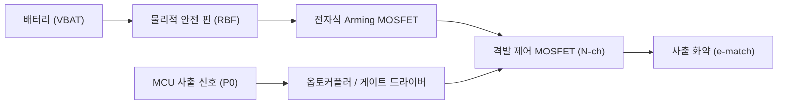

# 🪂 복구 및 사출 시스템 (Recovery System)

> [!IMPORTANT]
> 복구 시스템은 로켓의 안전한 감속 회수를 보장하는 최우선 안전 필수(P0) 서브시스템입니다.
> 비행 상태 판정과의 연계는 [[docs/wiki/systems/flight-state-machine|비행 상태 머신]]을 참조하십시오.

---

## 1. 개요 및 설계 목표

- **목표 고도**: 400 m 도달 후 정점(Apogee) 통과 즉시 낙하산 사출
- **허용 지연 시간**: 정점 판정 후 **1.0초 이내** 사출 화약 신호 인가 (`REQ-SYS-002`)
- **이중화 철학**: 센서 융합 실패 시에도 강제 타이머로 사출 보장 (`REQ-SYS-004`)

---

## 2. 정점(Apogee) 감지 알고리즘

정점 감지는 외란(돌풍, 음향 노이즈)에 의한 오발을 방지하기 위해 기압 고도와 가속도를 상호 보정합니다.

1. **기압 고도 감소 감지**:
   - 칼만 필터(Kalman Filter)를 통과한 수직 속도 $v_z < 0\text{ m/s}$ 가 5개 샘플(50 ms) 연속 감지될 때 1차 트리거.
2. **가속도 역전 판정**:
   - 모터 연소 종료 후 자유낙하 무중력(0G) 구간 검증.
3. **안전 백업 타이머 (Safety Backup Timer)**:
   - 발사 감지(`[BOOST]` 진입) 후 사전에 계산된 시뮬레이션 정점 도달 시간 $T_{apogee} + 1.5\text{ s}$ 초과 시, 센서 상태와 무관하게 무조건 사출 강제 격발.

---

## 3. 사출 회로 및 2중 안전 장치 (Safety Fixture)

> [!WARNING]
> 화약 격발 장치는 지상 대기 중 오발 시 심각한 인명 사고 및 기체 손상을 유발합니다. 반드시 물리적 2중 차단 절차를 준수합니다.

1. **물리적 차단 (Hardware Inhibit)**:
   - **RBF (Remove Before Flight) 핀**: 사출 전원선을 물리적으로 단선 상태로 유지. 발사대 거치 후 카운트다운 직전에만 제거.
2. **전자식 Arming 스위치**:
   - MCU 독립 안전 라인이 High 상태일 때만 사출 커패시터/전원 활성화.
3. **격발 드라이버**:
   - Logic-level N-채널 전력 MOSFET (최소 10A 펄스 허용) 사용.
   - 사출 신호 인가 시간: 1.0초 펄스 지속 후 자동 차단.

---

## 4. 위험 분석 매핑

| 위험 ID | 위험 내용 | 안전 대책 | 검증 여부 |
|---|---|---|---|
| **HAZ-001** | 지상 대기 중 사출 화약 오발 | RBF 핀 및 Arming 회로 2중 분리 | [[docs/wiki/verification/matrix\|REQ-SYS-001]] |
| **HAZ-002** | 정점 미감지로 인한 탄도 비행 | 센서 융합 + 백업 타이머 강제 격발 | [[docs/wiki/verification/matrix\|REQ-SYS-002]] |

---

## 5. 연관 문서
- [[docs/wiki/systems/flight-state-machine|비행 상태 머신]]
- [[docs/wiki/systems/flight-computer|비행 컴퓨터]]
- [[docs/wiki/interfaces/pinout-matrix|하드웨어 핀맵 매트릭스]]
- [[docs/wiki/verification/matrix|요구사항 검증 매트릭스 (REQ-SYS-002)]]
