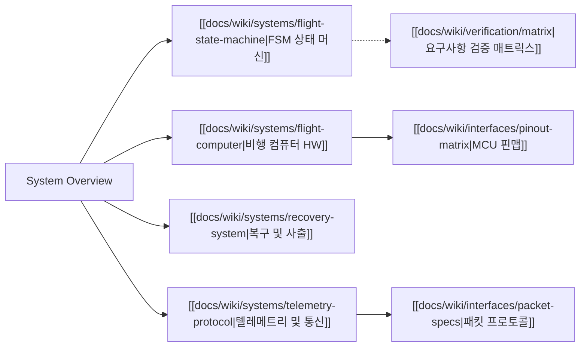

# 🛸 NURA Avionics 시스템 종합 개요

> [!NOTE]
> 본 문서는 NURA 400m 소형 로켓의 비행 컴퓨터, 펌웨어, 통신 및 복구 시스템을 아우르는 최상위 아키텍처 개요입니다.
> 전체 지식 맵은 [[docs/Index|Index (MOC)]]를 참조하십시오.

---

## 1. 개요 및 미션 목표

NURA 400m 프로젝트는 지표면 기준 목표 고도 **400 m**에 도달하고, 신뢰성 있는 자율 복구(사출)와 비행 데이터 온보드 기록 및 실시간 텔레메트리 송신을 완수하는 것을 목표로 합니다.

### 1.1 핵심 성공 기준
1. **비행 데이터 완전 로깅**: 발사부터 착륙까지 기압, 가속도, 각속도, GPS 등 전 과정 데이터 100 Hz 이상 무손실 기록.
2. **신뢰성 있는 정점 사출**: 최고 고도(Apogee) 도달 판정 후 자율 복구 장치 격발을 통한 기체 안전 감속 회수.
3. **지상국 실시간 링크**: 비행 상태 머신 및 주요 텔레메트리를 지상국으로 실시간 브로드캐스팅.

### 1.2 기능 계층 및 우선순위

| 우선순위 | 계층 명칭 | 핵심 기능 | 관련 위키 |
|---|---|---|---|
| **P0** | 최우선 안전 필수 | 안정적 전원 감시, 비행 상태 판정, 100Hz 온보드 로깅, 독립적 자율 사출 | [[docs/wiki/systems/flight-computer\|비행 컴퓨터]], [[docs/wiki/systems/recovery-system\|복구 시스템]] |
| **P1** | 원격 모니터링/보조 | 실시간 무선 텔레메트리 송신, 지상국 비상 명령/점검 업링크 수신 | [[docs/wiki/systems/telemetry-protocol\|텔레메트리/통신]] |
| **P2** | 고도화 제어 | Roll 축 안정화 및 Canard 능동 제어 (확장 기능) | [[docs/wiki/systems/flight-state-machine\|비행 상태 머신]] |

---

## 2. 서브시스템 지식 맵 (Architecture & Interlinks)

각 서브시스템은 독립적인 위키 엔티티 문서로 분리되어 관리됩니다:

- **비행 모드 및 상태 머신**: [[docs/wiki/systems/flight-state-machine|Flight State Machine (FSM)]]
- **비행 컴퓨터 하드웨어**: [[docs/wiki/systems/flight-computer|Flight Computer (HW/MCU)]]
- **사출 및 안전 복구**: [[docs/wiki/systems/recovery-system|Recovery & Safety System]]
- **무선 텔레메트리 규격**: [[docs/wiki/systems/telemetry-protocol|Telemetry & RF Protocol]]
- **인터페이스 정의**: [[docs/wiki/interfaces/pinout-matrix|핀맵 매트릭스]], [[docs/wiki/interfaces/packet-specs|패킷 규격서]]
- **요구사항 검증 현황**: [[docs/wiki/verification/matrix|검증 매트릭스 (Matrix)]]

---

## 3. 핵심 요구사항 (Key Requirements)

> [!IMPORTANT]
> 본 요구사항의 시험 절차 및 통과 여부는 [[docs/wiki/verification/matrix|검증 매트릭스]]에서 실시간으로 추적 관리됩니다.

- `REQ-SYS-001`: 400 m 비행 환경에서 기구적, 전기적 무결성 유지 (우선순위: P0)
- `REQ-SYS-002`: 정점 도달 판정 후 1.0초 이내에 사출 장치에 격발 신호 인가 (우선순위: P0)
- `REQ-SYS-003`: 비행 중 기압 및 9축 IMU 데이터를 100 Hz 이상으로 온보드 기록 (우선순위: P0)
- `REQ-SYS-004`: 무선 통신 두절 시에도 사출 및 로깅은 독자적으로 완수 (우선순위: P0)
- `REQ-SYS-005`: 비행 중 주요 상태 및 GPS 좌표를 5 Hz 이상으로 지상국에 전송 (우선순위: P1)

---

## 4. 위험 분석 및 안전 대책 (Hazards & Mitigation)

> [!WARNING]
> 로켓 시스템은 화약 및 고에너지 비행체를 포함하므로 아래 위험 대책을 엄격히 준수합니다.

| 위험 ID | 시나리오 | 영향도 | 안전 대책 (Mitigation) | 관련 서브시스템 |
|---|---|---|---|---|
| **HAZ-001** | 지상 대기 중 사출 화약 오발 | 안전 사고 및 기체 파손 | 물리적 RBF 핀 및 전기적 Arming 스위치 2중 차단 | [[docs/wiki/systems/recovery-system\|복구 시스템]] |
| **HAZ-002** | 정점 미감지로 인한 탄도 비행 | 지상 충돌 위험 | 센서 융합(기압+가속도) 및 타이머 기반 강제 사출 | [[docs/wiki/systems/flight-state-machine\|비행 상태 머신]] |
| **HAZ-003** | 전원 노이즈로 인한 MCU 재부팅 | 비행 제어 상실 | 전원 분리 설계 및 비휘발성 메모리 상태 복구 로직 | [[docs/wiki/systems/flight-computer\|비행 컴퓨터]] |
| **HAZ-004** | 진동으로 인한 배터리 이탈 | 시스템 전원 차단 | 잠금형 커넥터(Molex/JST-GH) 및 진동 완충재 고정 | [[docs/wiki/systems/flight-computer\|비행 컴퓨터]] |
